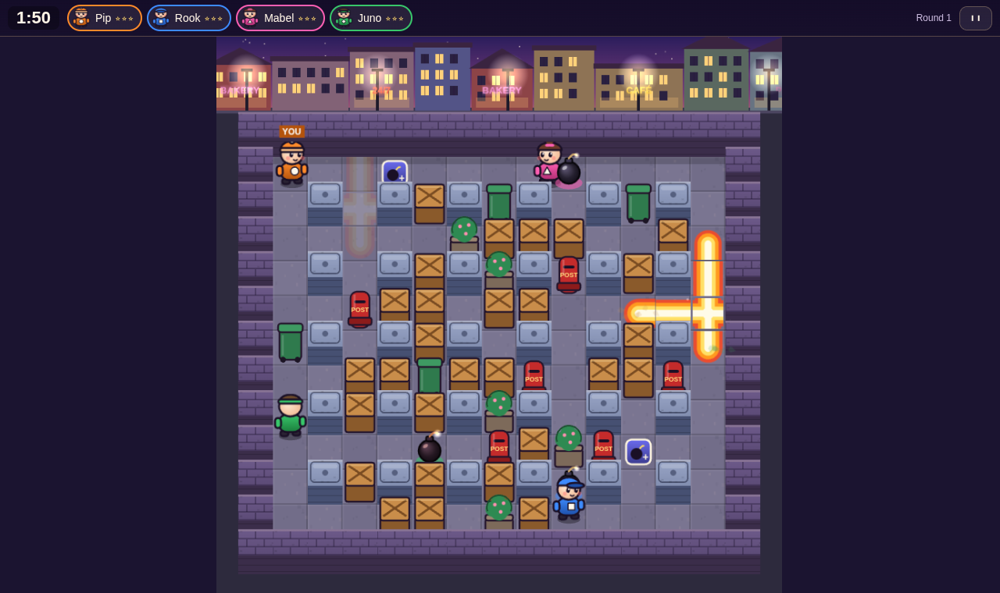
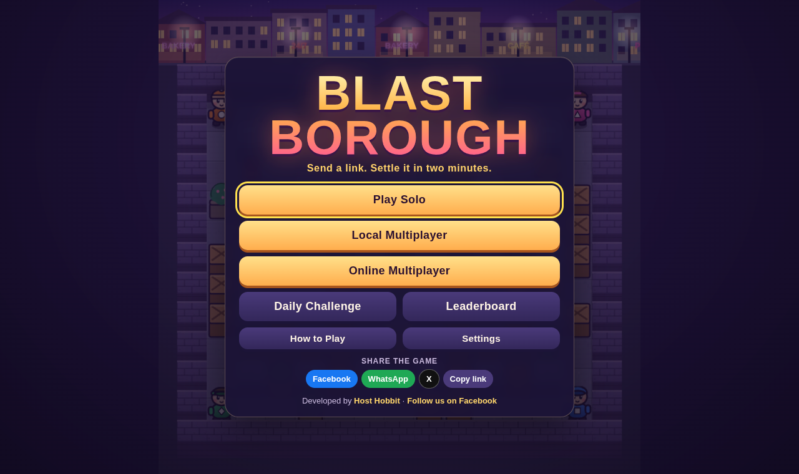
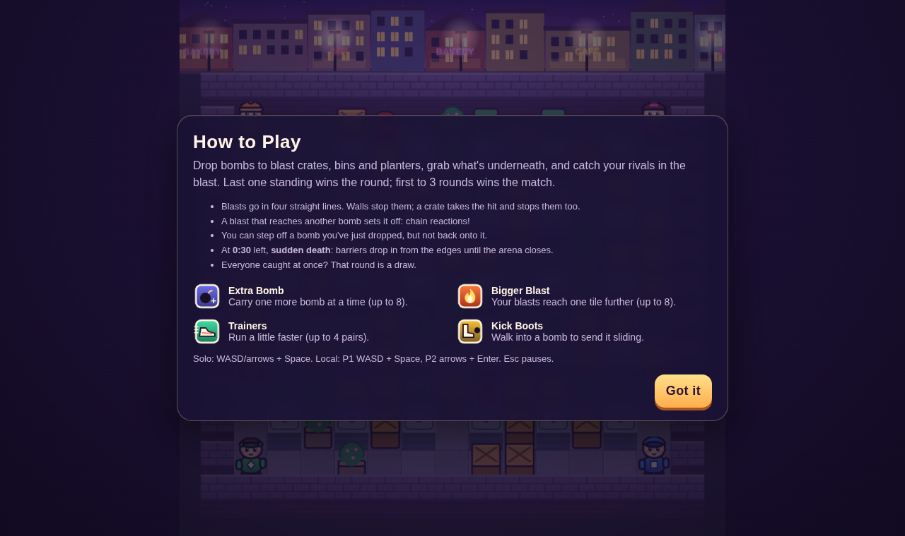
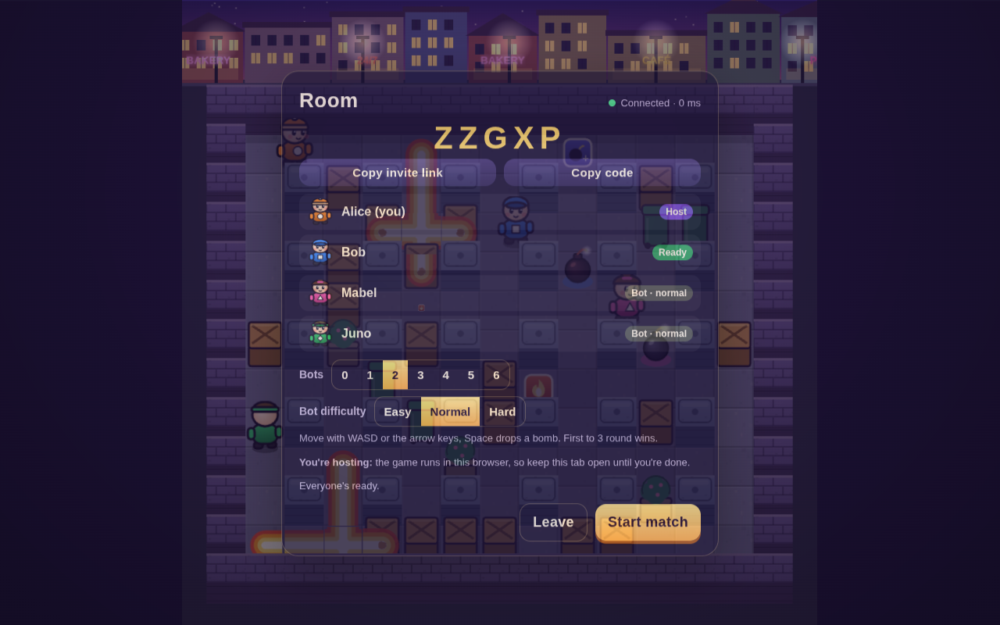
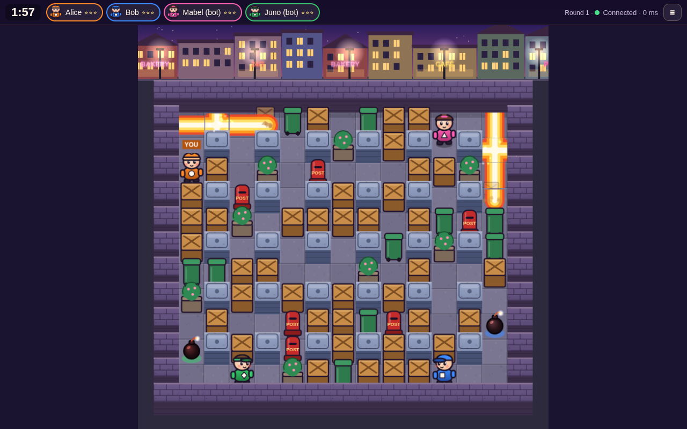
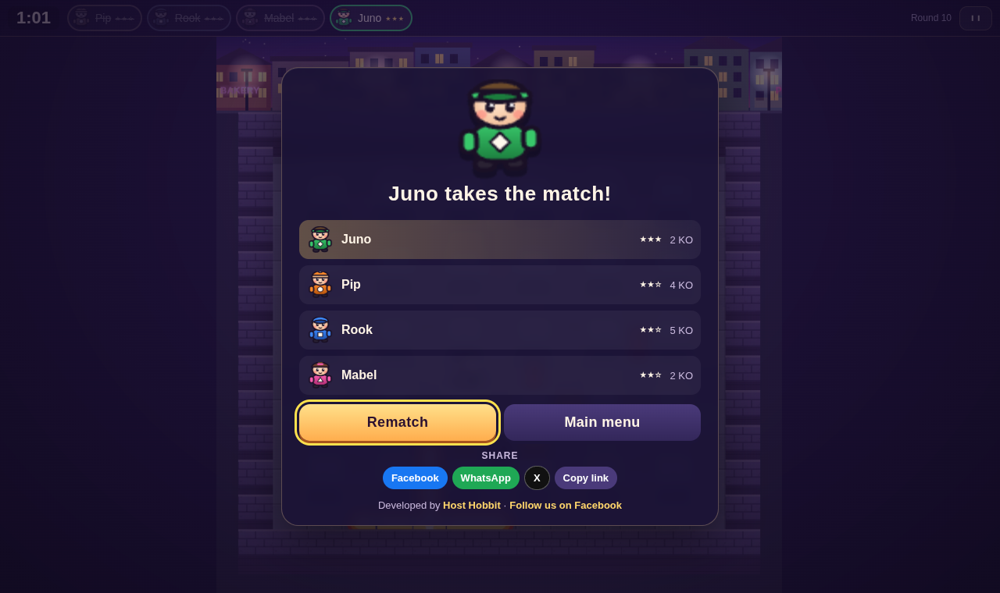
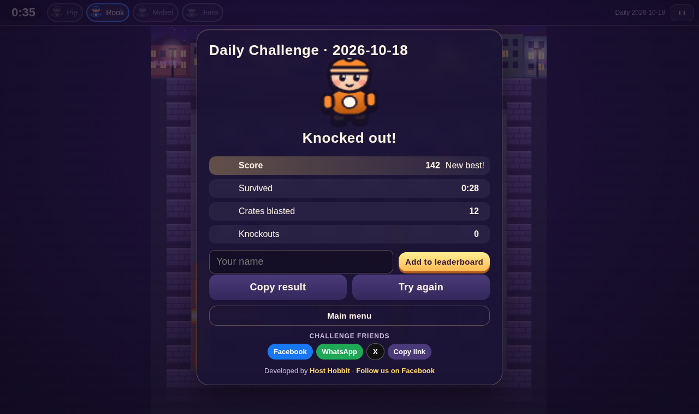
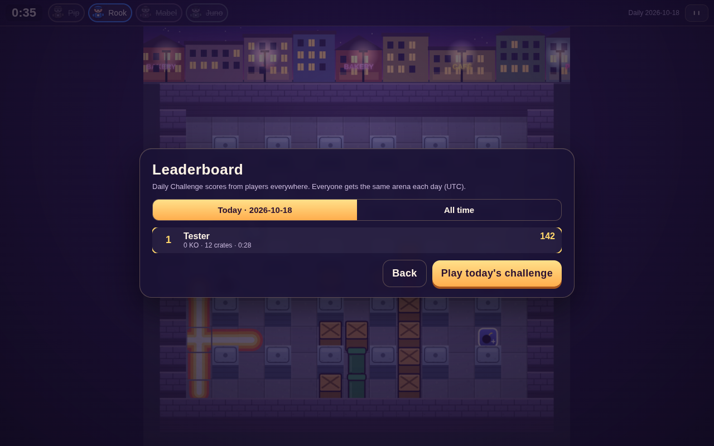
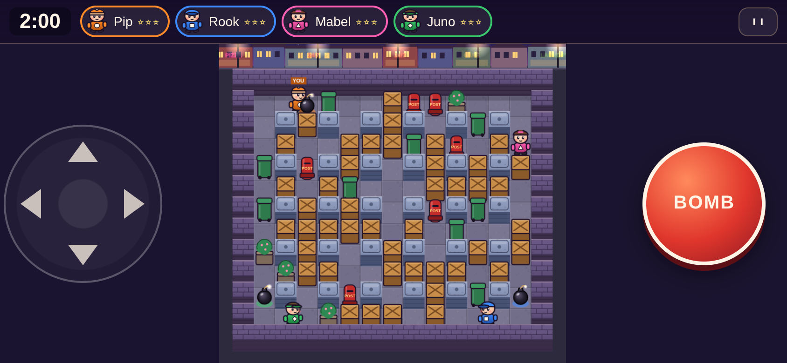

# Blast Borough

**Send a link. Settle it in two minutes.**

### ▶ Play now: [hosthobbit.github.io/blast-borough](https://hosthobbit.github.io/blast-borough/)

Free, in your browser, nothing to install. Works on computers, tablets and phones.



A grid-based bomb battle in a colourful neighbourhood at dusk. Drop bombs, blast crates, bins and planters, grab the power-ups underneath, and catch your friends in the blast. Last one standing wins the round; first to three rounds takes the match.

- **Play Solo** against three bots: Easy, Normal or Hard
- **Local Multiplayer**: two players on one keyboard, plus optional bots
- **Online Multiplayer**: private rooms for 2 to 8 players. Create a room, send the invite link, and play. Bots fill the empty spots
- **Daily Challenge**: the same arena for everyone each day, with a **public leaderboard** (today and all time)
- **Phones and tablets**: a touch D-pad and a big bomb button

Everything you see and hear was made for this game, in code: the characters, the neighbourhood, the sound effects and the music. No image or audio files, nothing borrowed.

| | |
| --- | --- |
|  |  |
|  |  |
|  |  |
|  | |



## How to play

| | Keyboard | Touch |
| --- | --- | --- |
| Move | WASD or arrow keys | Drag on the pad (left) |
| Drop a bomb | Space | BOMB button (right) |
| Pause / menu | Esc or P | ❚❚ button |
| Local player 2 | Arrow keys + Enter | (keyboard only) |

- Blasts go in four straight lines. Walls stop them. A crate, bin, planter or post box takes the hit, is destroyed and stops that arm.
- A blast that reaches another bomb sets it off at once: **chain reactions**.
- You can step off a bomb you've just dropped, but not back onto it. Bombs block everyone else.
- Turn a little early or late and you're helped round the corner.
- **Power-ups** hide under some crates:

| | Power-up | Effect |
| --- | --- | --- |
| 💣 | **Extra Bomb** | Carry one more bomb at a time (up to 8) |
| 🔥 | **Bigger Blast** | Your blasts reach one tile further (up to 8) |
| 👟 | **Trainers** | Run a little faster (up to 4 pairs) |
| 🥾 | **Kick Boots** | Walk into a bomb to send it sliding |

- Rounds last about two minutes. With **30 seconds left, sudden death** begins: barriers drop from the edges inwards until the arena is closed.
- Last player standing wins the round. If everyone left is caught at the same moment, it's a **draw**.

## Daily Challenge leaderboard

Every day (UTC) everyone gets the same arena, spawns and bots. Play one round and score points:

- survival time
- crates you blast
- power-ups you grab
- knockouts, 150 each
- a big bonus for winning, worth more the quicker you win

Then put your name on the public leaderboard. **Leaderboard** on the title screen shows today's top 20 and the best scores of all time.

The scores are kept by [`signal/blast-scores.php`](signal/blast-scores.php), live on hosthobbit.com:

- It recalculates every score from the round's stats, so typed-in numbers are rejected.
- It caps impossible stats.
- It only accepts today's (or just-finished yesterday's) challenge.
- It keeps one entry per name per day, your best.
- It filters rude names and rate-limits.

## Sharing

Share buttons for Facebook, WhatsApp and X, plus your phone's own share menu and Copy link, are on the title, results and daily screens. Players who've finished a match are shown a friendly "share it with your friends" card a few times, until they share. Sharing is always optional and never blocks play, as Facebook's rules require.

## Online play

Online rooms are **peer-to-peer**. Whoever creates a room hosts the game in their own browser, and friends' browsers connect straight to it (WebRTC). There's no game server to pay for or keep running.

1. **Online Multiplayer → Create a room.** You get a 5-letter code.
2. **Copy invite link** and send it (or just the code).
3. Friends open the link, enter a name and press **I'm ready**. The host can add bots.
4. The host presses **Start match**.

The only server involved is a tiny "introductions" script ([`signal/blast-signal.php`](signal/blast-signal.php)). It passes a couple of connection messages between browsers when someone joins, and nothing else: no gameplay goes through it. It runs on ordinary PHP hosting; the live game uses one at hosthobbit.com.

**Good to know**

- The host's browser runs the room, so **the host keeps that tab open** until everyone's finished. It keeps running if the host switches to another tab. If the host leaves, the room closes for everyone.
- If a guest drops out mid-match, a bot takes over their character and the match carries on.
- Some networks (often mobile data, or strict work or school Wi-Fi) block direct connections between browsers. The game tells you if that happens; trying another network or having someone else host usually fixes it.
- Players can't join a room while a match is running, only between matches.

There's also an optional **dedicated server mode** (below) for anyone who'd rather run a proper always-on server.

## Running it yourself

Needs Node.js 20 or newer.

```bash
npm install
npm run dev            # http://localhost:5173
```

Solo, local and daily modes need nothing else. Online rooms use the introductions script at hosthobbit.com by default; set `VITE_SIGNAL_URL` to use your own.

| Command | What it does |
| --- | --- |
| `npm run dev` | Dev server for the game |
| `npm test` | Unit and integration tests (Vitest): rules, bots, rooms and server |
| `npm run test:e2e` | Browser tests in headless Chromium (needs PHP for the online tests; see below) |
| `npm run typecheck` | TypeScript checks |
| `npm run build` | Typecheck, build the game to `dist/` and the optional server to `dist-server/` |
| `npm run preview` | Serve the built game locally |
| `npm run dev:server` / `npm run start:server` | The optional dedicated server (dev / built) |

### Configuration

Copy `.env.example` to `.env`. Nothing in it is secret.

| Variable | Used by | Default | Meaning |
| --- | --- | --- | --- |
| `VITE_SIGNAL_URL` | game (build time) | `https://hosthobbit.com/games-api/blast-signal.php` | The introductions script for peer-to-peer rooms |
| `VITE_SCORES_URL` | game (build time) | `https://hosthobbit.com/games-api/blast-scores.php` | The public Daily Challenge leaderboard |
| `VITE_SERVER_URL` | game (build time) | unset | If set (e.g. `wss://blast.example.com`), online play uses this dedicated server instead of peer-to-peer |
| `PORT`, `ALLOWED_ORIGINS`, `MAX_ROOMS` | dedicated server | `8787`, any, `200` | Port, allowed page origins, room cap |

### Hosting the game

`npm run build`, then upload `dist/` to any static host. The leaderboard and the online introductions use `VITE_SCORES_URL` and `VITE_SIGNAL_URL` (both default to hosthobbit.com). It works from any path. The live version is on GitHub Pages: the `gh-pages` branch is the contents of `dist/` plus an empty `.nojekyll` file.

### Hosting the PHP scripts (introductions and leaderboard)

Copy [`signal/blast-signal.php`](signal/blast-signal.php) and [`signal/blast-scores.php`](signal/blast-scores.php) to any PHP 8 host with SQLite, e.g. `public_html/games-api/`.

- It keeps a small SQLite file outside the web root, in `~/game-scores/`, or `BLAST_SIGNAL_DIR` if set.
- It cleans up after itself: rooms vanish 2 minutes after their host stops checking in.
- It rate-limits requests per IP address.
- Edit the allowed origin near the top of the script to match where your game is hosted, then build the game with `VITE_SIGNAL_URL` pointing at the script.

### The dedicated server (optional)

The same room code also runs as a Node.js WebSocket server, in `server/`. It's handy if you'd rather not rely on direct browser connections. It needs a host that runs Node and allows WebSockets, such as a VPS, Fly.io or Render. Ordinary PHP hosting won't do.

```bash
npm ci && npm run build
PORT=8787 ALLOWED_ORIGINS=https://your-game-site.example node dist-server/server/index.js
VITE_SERVER_URL=wss://blast.example.com npm run build     # point the game at it
```

Put it behind HTTPS so `https://` pages can use `wss://`. For example, with nginx:

```nginx
location / {
  proxy_pass http://127.0.0.1:8787;
  proxy_http_version 1.1;
  proxy_set_header Upgrade $http_upgrade;
  proxy_set_header Connection "upgrade";
  proxy_read_timeout 1h;
}
```

`GET /health` returns `{"ok":true,"rooms":N}`.

## How it's built

TypeScript throughout: [Phaser 3](https://phaser.io) for the arena, plain HTML for menus, Vite for the build.

```
shared/        game rules, used everywhere
  sim.ts         the simulation: fixed 30 Hz tick, integer positions, seeded randomness: reproducible matches
  map.ts         arena generation with fair spawns
  bot.ts         bots: forecast of blast times (chain reactions included), escape checks before bombing
  rooms.ts       rooms, lobby and authoritative matches (runs in the Node server or in the host's browser)
  protocol.ts    online messages, validation, snapshots
client/        the game in the browser
  game/            renderer (knows nothing about the rules), art drawn in code, local matches
  p2p/             peer-to-peer: host worker, WebRTC connections, introductions
  net.ts           online play: inputs, prediction for your own player, smoothing for everyone else
  audio.ts         synthesised sound effects and music
server/        optional dedicated Node.js server
signal/        PHP: online introductions + Daily Challenge leaderboard
tests/         Vitest
e2e/           headless browser tests and README screenshots
```

**Online, in detail:**

- Whoever runs the room (the host's browser, or the dedicated server) owns the simulation.
- Players only send their inputs, one per tick (a direction and a bomb press). These are validated, rate-limited and queued.
- The room sends snapshots 15 times a second. Hidden power-ups are never included.
- Your own character is predicted locally with the same movement code and corrected against the room. Everyone else is smoothed between snapshots.
- In peer-to-peer rooms, the room runs in a Web Worker in the host's browser, so it keeps ticking when the tab isn't visible.

## Testing

- **`npm test`: 33 tests.**
  - The rules: blast blocking, crates, chain reactions and their timing, bomb occupancy and walking off a new bomb, kicking, power-up limits, simultaneous deaths and draws, first-to-three, sudden death timing.
  - Maps: reproducible from the seed; safe spawns with a survivable opening, checked on 60 maps × 4 players.
  - Bots: forecasts, escaping blasts, never bombing into a dead end, full bot rounds, determinism.
  - Online over real WebSockets: full matches with rematch, invalid and malicious messages, host handover, bots replacing leavers, room cleanup, rate limits and size caps.
- **`npm run test:e2e`: 8 browser scenarios.**
  - A complete solo match plus rematch.
  - Two-player keyboard controls with pause and no page scrolling.
  - **Two browsers playing a peer-to-peer online round over WebRTC**, then one leaving and a bot taking over.
  - The host leaving.
  - Clear errors when the room service is unreachable or a code is wrong.
  - The phone layout in landscape and portrait, with touch steering and bombing.
  - The daily challenge, including submitting to the public leaderboard and finding the entry there.
  - Keyboard-only menus.
  - The run fails on any browser console error.
  - The online tests serve `signal/blast-signal.php` with a local `php` (set `PHP_BIN` if it isn't at `~/.local/opt/php/php`), and use the system Chromium (`CHROME=/path` to override).

## Limitations

- Tested in desktop Chromium and a phone emulator, not yet on real phones and tablets. Performance on older phones is unknown.
- Peer-to-peer rooms depend on the host's browser and connection, and some networks block direct connections (see above).
- No reconnection: a player who drops out is replaced by a bot for the rest of that match.
- Leaderboard scores are checked for consistency, not replayed, so a determined cheat could still craft a plausible score.
- Two-player local mode needs a keyboard, so it's for computers.
- Ideas for later: a map editor, cosmetic unlocks, a revenge mode.

## Credits

Game design, code, art, sound and music made for this project. Built with [Phaser 3](https://phaser.io) (MIT) and [ws](https://github.com/websockets/ws) (MIT). Direct connections use public STUN servers from Google and Cloudflare to help browsers find each other.

© Host Hobbit Ltd · [hosthobbit.com](https://hosthobbit.com)
